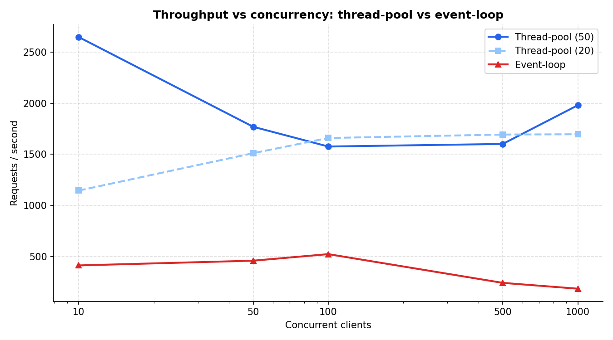
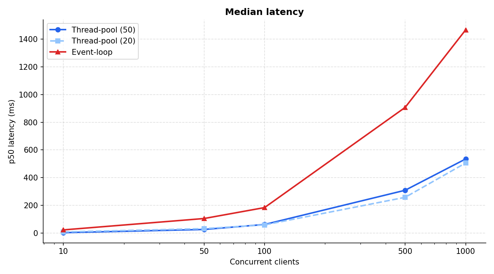
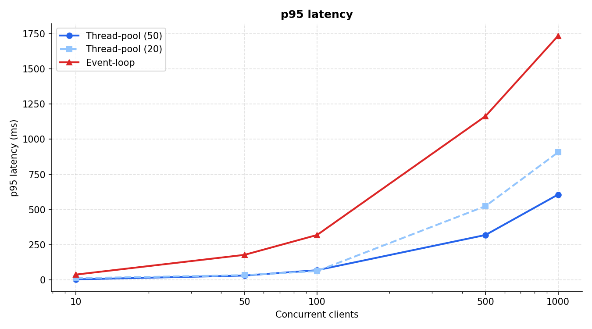
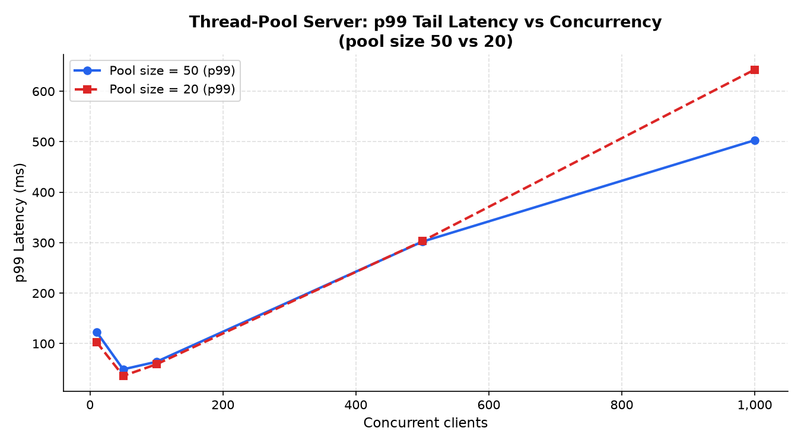
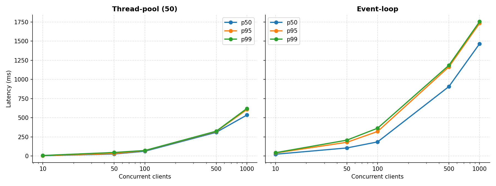
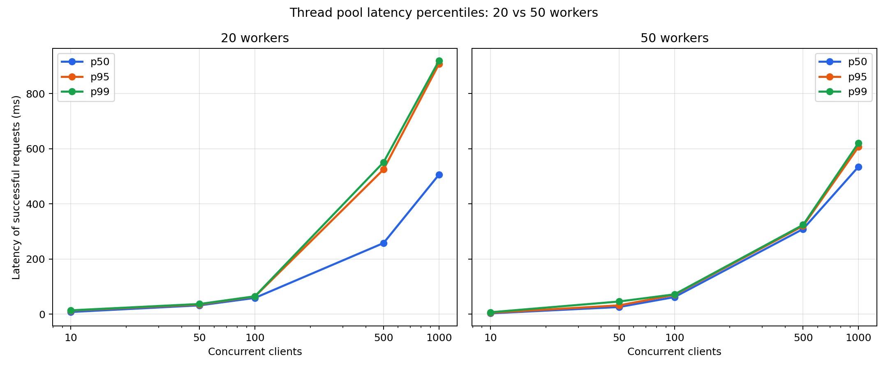
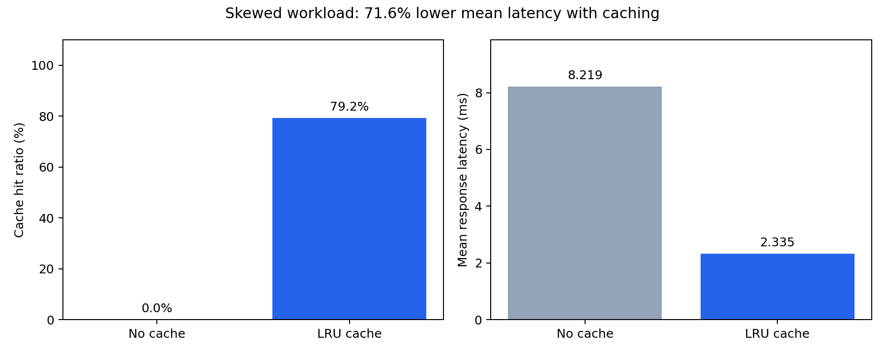

# P1 — HTTP/1.1 Server and Caching Proxy

CS-30003 Coding Assignment 1 — a from-scratch HTTP/1.1 server built
directly on TCP sockets (no HTTP libraries), with two interchangeable
concurrency models and a forward proxy with an LRU cache.

---

## Team

| Name | Roll | Component owned |
|---|---|---|
| Ahan Bhattacharjee | 2405408 | Thread-pool concurrency model, benchmark harness |
| Kaustav Ghosh | 2405439 | Static file serving, forward proxy, LRU cache, ETag/304, cache experiment |
| Puskar Das | 24052165 | Event-loop concurrency model, keep-alive, chunked encoding |
| Aniket Ghosh | 24052131 | TCP server core: HTTP parsing, status codes, buffering |

---

## What we built

An HTTP/1.1 server from raw TCP sockets — parsing requests and generating
responses ourselves, with no HTTP library. The server sits at the application
layer over TCP. Its two core challenges are correct byte-stream framing (a TCP
stream is not a sequence of HTTP messages) and comparing two different
concurrency models for handling simultaneous clients.

---

## The claim we tested

**Hypothesis:** the event-loop (java.nio Selector) concurrency model sustains
higher requests/sec and lower tail latency (p95/p99) than the thread-pool model
as concurrent client count grows, with the gap widening past the point where
thread count exceeds available cores.

**Outcome:** throughput part supported from ~100 clients onward; tail-latency
part only partly supported — see Experiment 4 in `docs/benchmark-analysis.md`.

---

## Stack

- **Server core:** Java — `java.net` sockets, `java.util.concurrent` thread
  pools, `java.nio.Selector` for the event loop. Standard socket API only;
  no HTTP libraries.
- **Plotting:** Python (matplotlib, pandas) — experiment graphs only.

---

## Repository layout

```
src/
  server/     HTTP parsing, both concurrency models, static file handler
  proxy/      ForwardProxy, LruCache, CachePolicy, ETagGenerator,
              ConditionalGet, CacheStats
  benchmark/  LoadTester, SweepRunner, CacheWorkload
test/         Unit and integration tests (no JUnit — plain Java main())
test-site/    Static files served during benchmarks and manual tests
results/      Experiment CSVs and plots/
scripts/      plot_results.py, plot_cache.py, plot_threadpool_latency.py,
              requirements.txt, run_sweep.sh
docs/         Proposal, benchmark analysis, parser design notes
AI-USE.md     Disclosure log of AI tool usage (required by assignment)
```

> The work schedule references `HttpRequestParser.java` — the actual
> implementation uses `RequestParser.java` (same functionality, different
> name adopted during implementation).

---

## Building

**Windows PowerShell** (from repo root):
```powershell
# src only
javac -d out (Get-ChildItem -Recurse -Filter *.java src | ForEach-Object { $_.FullName })

# src + test (needed to compile and run tests)
javac -d out (Get-ChildItem -Recurse -Filter *.java src,test | ForEach-Object { $_.FullName })
```

**Linux / Mac**:
```bash
# src only
javac -d out $(find src -name "*.java")

# src + test
javac -d out $(find src test -name "*.java")
```

---

## Running

```bash
# Thread-pool server — port 9091, pool size 50
java -cp out server.ThreadPoolServer 9091 50

# Event-loop server — port 8081, idle timeout 5 s, doc root test-site/
# Bodies above 64 KB are sent chunked (HTTP/1.1 only; -1 disables chunking)
java "-Deventloop.chunk.threshold=65536" -cp out server.EventLoopServer 8081 5 test-site

# Forward proxy — port 8082
java -cp out proxy.ForwardProxy 8082

# Load test: 20 concurrent clients × 10 requests each, targeting port 9091
java -cp out benchmark.LoadTester localhost 9091 20 10

# Concurrency sweep — thread-pool
java -cp out benchmark.SweepRunner localhost 9091 results/threadpool_rps.csv 3

# Concurrency sweep — event-loop
java -cp out benchmark.SweepRunner localhost 8081 results/eventloop_rps.csv 3

# Cache experiment (1000 requests, 100 resources, LRU capacity 32, 5 ms origin delay, 3 rounds)
java -cp out benchmark.CacheWorkload 1000 100 32 5 3

# Generate benchmark comparison plots
python scripts/plot_results.py

# Generate cache hit-ratio plot
python scripts/plot_cache.py

# Generate thread-pool pool-size comparison plot
python scripts/plot_threadpool_latency.py
```

---

## Default ports

| Component | Default port |
|---|---|
| ThreadPoolServer | 8080 (benchmarks use 9091 explicitly) |
| EventLoopServer | 8081 |
| ForwardProxy | 8082 |
| LoadTester / SweepRunner | targets 9091 by default |

---

## Tests

```bash
# Unit tests (no server needed)
java -cp out LruCacheTest
java -cp out ChunkedEncodingTest
java -cp out TraversalTest
java -cp out ParserFuzzTest

# Pipelining test
java -cp out PipelineTest

# Status code end-to-end test (starts both servers internally)
java -cp out StatusCodeTest
```

---

## Status

- [x] Repo initialised, shared `RequestHandler` interface
- [x] TCP accept loop, request-line and header parsing
- [x] GET and HEAD with correct status codes (200, 304, 400, 403, 404, 405, 414, 431, 500, 505)
- [x] Static file serving — MIME types, directory-traversal protection
- [x] Thread-pool concurrency model
- [x] Event-loop concurrency model (`java.nio` Selector)
- [x] Keep-alive — event-loop model
- [x] Chunked transfer encoding — wired into EventLoopServer for bodies > 64 KB
- [x] Forward proxy + LRU cache (Cache-Control: no-store, no-cache, max-age)
- [x] ETag generation (`ETagGenerator`) and conditional GET (`ConditionalGet`, If-None-Match / If-Modified-Since / 304)
- [x] Cache hit-ratio experiment and plots (`CacheWorkload`, `CacheStats`)
- [x] Benchmark harness — LoadTester, SweepRunner, all plots
- [x] Event-loop benchmark runs

---

## Results (thread-pool model, pool size 50)

Machine: KIIT laptop, Windows 11, same machine for server and load generator.
Method: global warm-up of 3,000 requests, per-level warm-up, 90 s cooldown
between runs, 20 requests per client, listen backlog 1024.

| Concurrency | Req/sec | p50 (ms) | p95 (ms) | p99 (ms) | Errors |
|---|---|---|---|---|---|
| 10 | 2647 | 3 | 5 | 7 | 0 |
| 50 | 1769 | 26 | 32 | 46 | 0 |
| 100 | 1575 | 62 | 70 | 72 | 0 |
| 500 | 1601 | 309 | 320 | 324 | 0 |
| 1000 | 1979 | 535 | 607 | 621 | 488 / 20,000 |

---

## Results (event-loop model, same machine)

| Concurrency | Req/sec | p50 (ms) | p95 (ms) | p99 (ms) | Errors |
|---|---|---|---|---|---|
| 10 | 405 | 18 | 48 | 114 | 0 |
| 50 | 980 | 43 | 99 | 140 | 0 |
| 100 | 2222 | 40 | 71 | 89 | 0 |
| 500 | 2274 | 201 | 374 | 472 | 0 |
| 1000 | 3581 | 254 | 489 | 579 | 19669 / 20,000 |

---

## Results (cache experiment)

LRU capacity 32, 100 distinct resources, Zipf-skewed workload, 5 ms simulated
origin delay, 1000 requests per round, 3 rounds.

| Mode | Requests | Cache hits | Hit ratio | Avg latency (ms) | p50 (ms) | p95 (ms) |
|---|---|---|---|---|---|---|
| no_cache | 1000 | — | 0% | 8.42 | 8.35 | 9.73 |
| cached | 1000 | 792 | 79.2% | 2.46 | 0.93 | 8.84 |

---

## Plots

### Throughput (req/sec) vs concurrency


---

### Median latency (p50) vs concurrency



---

### p95 latency vs concurrency



---

### Tail latency (p99) vs concurrency



---

### Latency percentile spread (p50 / p95 / p99)



---

### Thread-pool: pool-20 vs pool-50 latency



---

### Cache performance



---

## AI usage

See `AI-USE.md` for full disclosure. AI was used for explaining concepts,
generating draft code, and debugging. The core protocol implementation was
written and understood by the team. Each member can explain their own module
line by line.

---

## Weekly plan

See `docs/CS-30003(P1).docx` for the full 8-week plan and work split.
