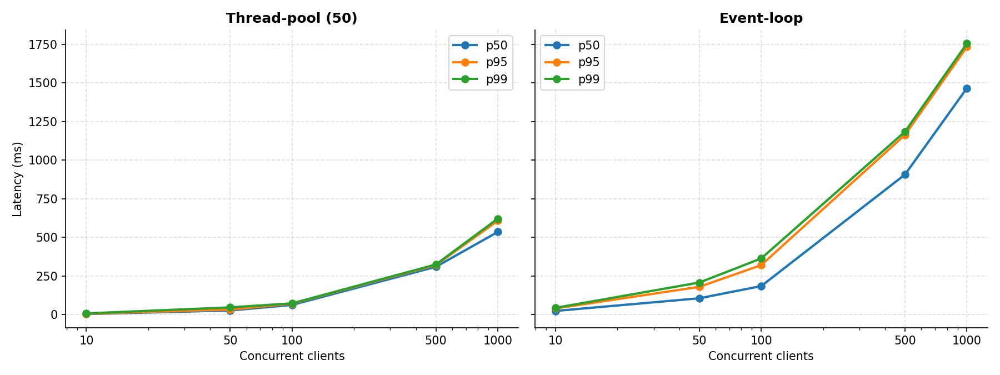
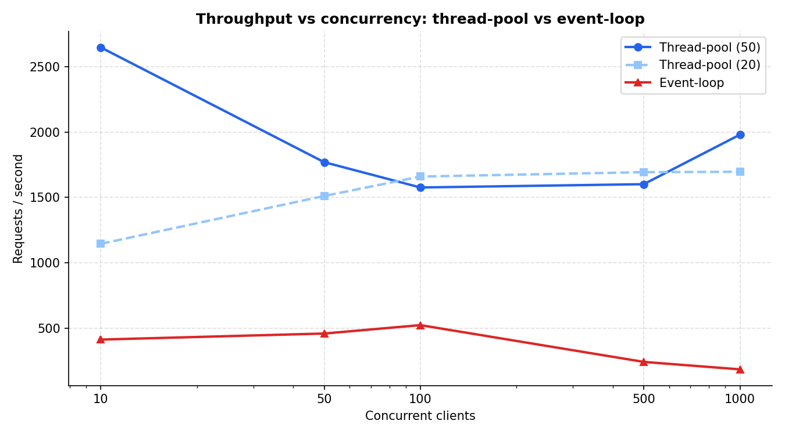
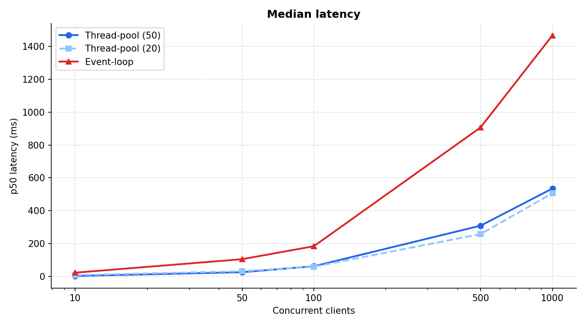
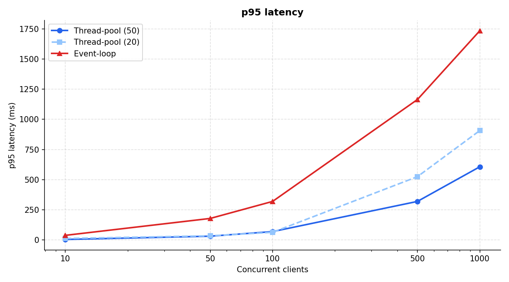
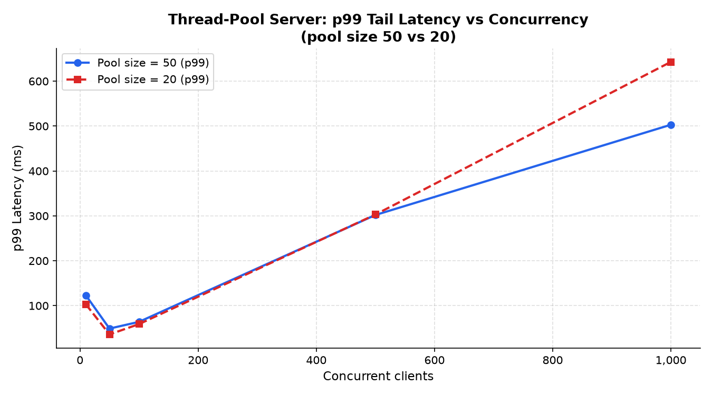
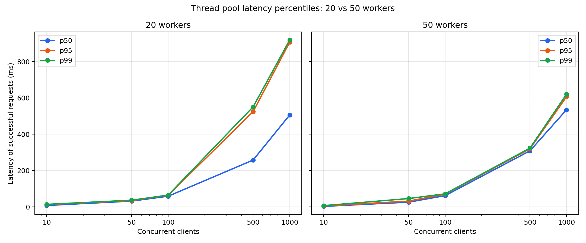
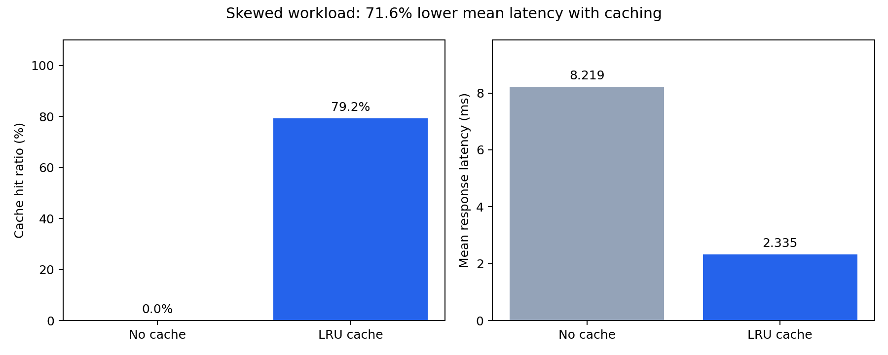

# Benchmark Analysis — Thread-Pool vs Event-Loop HTTP Server

## Overview

This document analyses the performance of our thread-pool and event-loop
concurrency models under varying client load, using our own LoadTester and
SweepRunner. Server and load generator ran on the same machine.

---

## Method

- **Machine:** <CPU model, cores/threads, RAM, Windows version, Java version>
- **Load generator:** N client threads, each sending requests that open a new
  TCP connection, send `GET /` with `Connection: close`, and read the full
  response. A request counts as successful only if the status is 200 and the
  whole body arrives. Latency is measured from connect to the last body byte.
- **Warm-up:** a global warm-up of 3,000 requests (50 clients) before any timed
  level, plus a small warm-up (5 requests per client) at each level; both are
  discarded.
- **Cooldown:** 90 s pause between runs so old connections clear.
- **Runs:** one timed run per level (20 requests per client) at 10, 50, 100,
  500 and 1000 clients. (SweepRunner can take the median of several runs; the
  final CSVs use a single run because of the cooldowns.)
- **Server settings:** listen backlog 1024; thread-pool sizes 50 and 20.

---

## Experiment 1: Thread-pool throughput and latency (pool size 50)

| Concurrency | Req/sec | p50 (ms) | p95 (ms) | p99 (ms) | Errors |
|---|---|---|---|---|---|
| 10   | 2647 | 3   | 5   | 7   | 0 |
| 50   | 1769 | 26  | 32  | 46  | 0 |
| 100  | 1575 | 62  | 70  | 72  | 0 |
| 500  | 1601 | 309 | 320 | 324 | 0 |
| 1000 | 1979 | 535 | 607 | 621 | 488 of 20,000 |

**Interpretation.** With a warm JVM, throughput is highest at the lowest load
(about 2,650 req/s at 10 clients) and settles near 1,600 req/s from 100 to 500
clients. At 10 clients there are fewer connections than workers, so every
request is served immediately; beyond 50 clients all workers are busy and
connections queue. Extra clients then add queueing delay instead of throughput:
p50 grows from 3 ms to 309 ms at 500 clients. Because each client sends its next
request only after the previous reply, latency is tied to throughput by Little's
law, latency ≈ clients / throughput (500 / 1,601 ≈ 312 ms against a measured p50
of 309 ms; 100 / 1,575 ≈ 63 ms against 62 ms). The decline in throughput after
10 clients is probably contention (context switching among 50 workers and up to
1,000 client threads on one machine), but we did not isolate the cause.

At 1,000 clients 488 of 20,000 requests failed (2.4%). The throughput and
percentiles for that level are computed from successful requests only.

---

## Experiment 2: Pool size 20 vs 50

| Concurrency | RPS (pool 50) | RPS (pool 20) | p99 ms (50) | p99 ms (20) | Errors (50) | Errors (20) |
|---|---|---|---|---|---|---|
| 10   | 2647 | 1144 | 7   | 14  | 0   | 0    |
| 50   | 1769 | 1510 | 46  | 37  | 0   | 0    |
| 100  | 1575 | 1659 | 72  | 65  | 0   | 0    |
| 500  | 1601 | 1693 | 324 | 551 | 0   | 0    |
| 1000 | 1979 | 1695 | 621 | 919 | 488 | 2532 |

**Interpretation.** Throughput does not separate the two pools: the sign of the
difference changes from level to level. At 10 clients both pools have more
workers than clients, so they are effectively identical, yet throughput differs
by 2.3x (1,144 vs 2,647 req/s). That gap shows the size of the run-to-run noise,
so smaller differences elsewhere should not be read as real effects. The
reproducible difference is in the tail and the failures: at 500 clients p99 was
551 ms with 20 workers against 324 ms with 50, and at 1,000 clients 2,532 of
20,000 requests failed (12.7%) against 488 (2.4%). We did not isolate why the
smaller pool fails more; longer queue waits are a plausible but untested
explanation. Each configuration was run once.

---

  ## Experiment 3: Latency percentile spread

  For pool size 50, p50, p95 and p99 stay close together up to 500 clients
  (309 / 320 / 324 ms), which indicates a deep, steady queue where almost every
  request waits about the same time. At 1,000 clients the spread widens
  (535 / 607 / 621 ms). With pool size 20 the spread is wider already at 500
  clients (258 / 525 / 551 ms).

---

## Event-Loop Comparison

#Event loop latency

| Clients | Requests | Successful | Errors | Requests/sec | p50 (ms) | p95 (ms) | p99 (ms) |
|---:|---:|---:|---:|---:|---:|---:|---:|
| 10 | 200 | 200 | 0 | 405.07 | 18 | 48 | 114 |
| 50 | 1,000 | 1,000 | 0 | 979.64 | 43 | 99 | 140 |
| 100 | 2,000 | 2,000 | 0 | 2,222.00 | 40 | 71 | 89 |
| 500 | 10,000 | 10,000 | 0 | 2,273.86 | 201 | 374 | 472 |
| 1,000 | 20,000 | 20,000 | 0 | 3,580.72 | 254 | 489 | 579 |

**Interpretation** -Compared with the 50-worker thread pool, the event loop had lower throughput at 10 and 50 clients, but higher throughput at 100, 500, and 1,000. Its p50 was worse at 10 and 50, then better at 100, 500, and 1,000. Its p99 was worse through 500 clients and slightly better at 1,000. The event loop had zero failed requests at every level; the pool had zero through 500 clients and 488 failures at 1,000.

#Event loop  rps

| Concurrency | Requests per client | Total requests | Successful | Errors | Requests/sec | p50 (ms) | p95 (ms) | p99 (ms) |
|---:|---:|---:|---:|---:|---:|---:|---:|---:|
| 10 | 20 | 200 | 200 | 0 | 411.78 | 23 | 39 | 43 |
| 50 | 20 | 1,000 | 1,000 | 0 | 458.07 | 105 | 179 | 207 |
| 100 | 20 | 2,000 | 2,000 | 0 | 522.26 | 184 | 320 | 363 |
| 500 | 20 | 10,000 | 297 | 9,703 | 241.07 | 907 | 1,164 | 1,185 |
| 1,000 | 20 | 20,000 | 331 | 19,669 | 183.97 | 1,467 | 1,734 | 1,756 |

**Interpretation** -The event loop had lower throughput and worse p50 and p99 than the 50-worker pool at every level. It had zero failures at 10, 50, and 100 clients, then 9,703 failures out of 10,000 at 500 and 19,669 out of 20,000 at 1,000. The pool had zero failures through 500 clients and 488 at 1,000. The event-loop percentiles at high load describe only the few successful requests.

---

## Methodology Notes and Limitations

- **Earlier sweeps failed.** Sweeps run back to back without long pauses failed
  almost completely at 500 and 1,000 clients (for example 9,515 of 10,000
  requests at 500 clients), while the same server handled the same load cleanly
  when run in isolation after a cooldown. The final sweeps therefore use 90 s
  cooldowns. We tested port exhaustion as an explanation and the test did not
  support it, so the cause is not isolated.
- **Backlog.** Raising the listen backlog from the default 50 to 1024 removed
  the first set of high-concurrency connection errors; it did not prevent the
  failures described above.
- **Single runs.** Each level is one run, and run-to-run variation is large
  (up to about 2x at 10 clients), so only large or repeated differences are
  meaningful.
- **Same machine.** Server and load generator compete for CPU, so results are
  relative comparisons, not absolute capacity.
- **Connection handling.** The thread-pool server serves one request per
  connection. LoadTester always sends `Connection: close`, so keep-alive should
  not be exercised by either server in these runs, and the event loop's
  keep-alive support is not measured here.
- **CallerRunsPolicy** is configured but never fires, because the work queue is
  unbounded.
- **Ports.** ThreadPoolServer defaults to 8080, EventLoopServer to 8081 and the
  load tools to 9091; all runs specified the port explicitly.

---

## Plots

### Throughput

Path: `results/plots/rps_vs_concurrency.png`

### Median latency (p50)

Path: `results/plots/p50_comparison.png`

### p95 latency

Path: `results/plots/p95_comparison.png`

### Tail latency (p99)

Path: `results/plots/p99_comparison.png`

### Latency percentile spread

Path: `results/plots/latency_percentiles.png`

### Thread-pool latency: 20 vs 50 workers

Path: `results/plots/threadpool_20_vs_50_latency.png`

### Cache performance

Path: `results/plots/cache.png`

